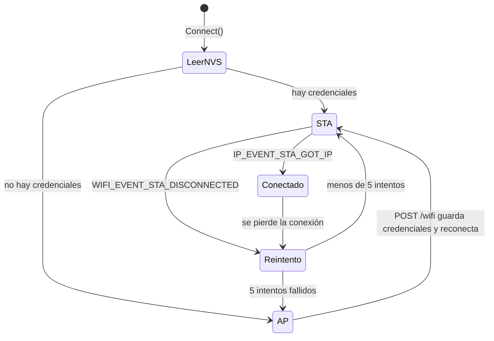
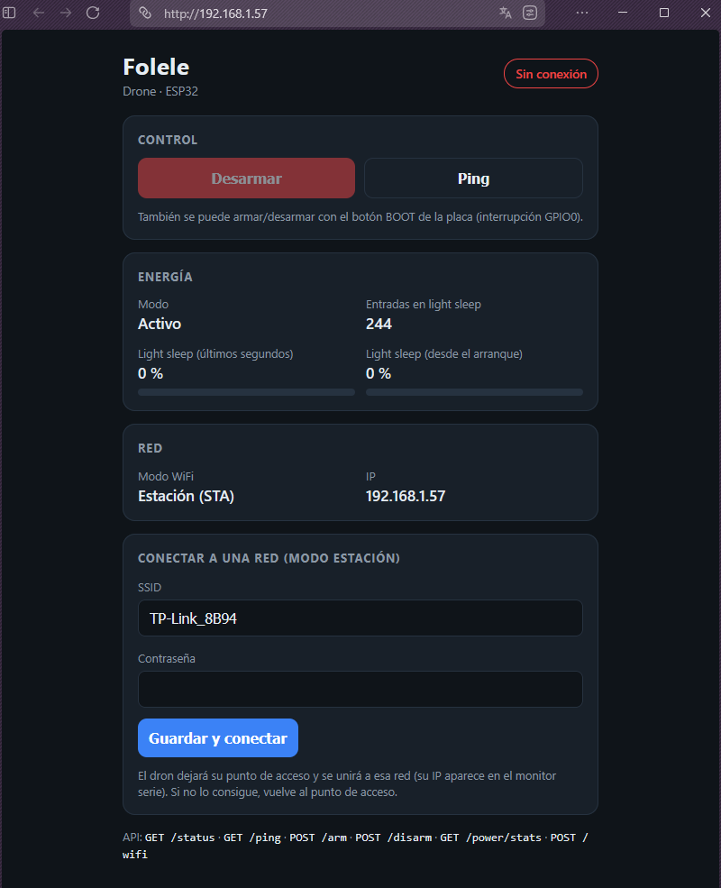
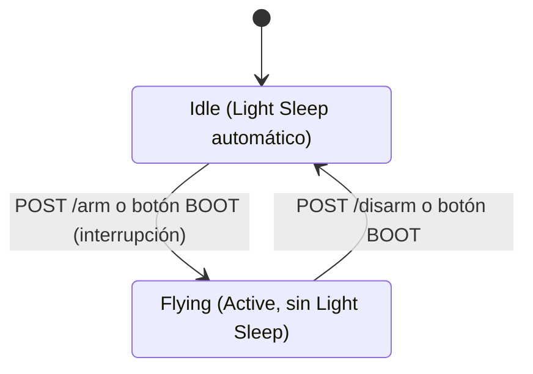

# Folele: informe de la práctica

**Folele** es el firmware de un dron de dos motores con un **ESP32 DevKit (ESP32-WROOM-32)**, escrito en C++ sobre **ESP-IDF v5.5** (el framework oficial de Espressif, sin el core de Arduino).

El dron lee un joystick y una IMU, mueve dos motores y publica un servidor web por WiFi desde el que se controla. Cuando está en tierra y desarmado entra en **Light Sleep** para reducir el consumo, y se despierta con un botón (interrupción) o con una petición WiFi.

- Código: carpeta [`core/`](../core) de este repositorio.
- Vídeo de demostración: **[enlace al vídeo]**

---

## 1. Requisitos de la práctica

| Requisito | Cómo se cumple | Dónde |
|---|---|---|
| Lectura de un sensor / activar un actuador | Joystick (ADC), IMU MPU-6050 (I²C), motores con PWM (LEDC), LEDs | `src/system/` |
| Comunicación por WiFi | Servidor HTTP que **recibe** órdenes (`/arm`, `/disarm`, `/wifi`) y **envía** datos (`/status`, `/ping`, `/power/stats`). Modos STA y AP | `src/network/`, `src/handlers/` |
| Modo de energía y forma de despertarlo | **Light Sleep automático** en reposo. Se despierta con el **botón BOOT (GPIO0)** o con **`POST /arm` por WiFi** | `src/system/power_manager.cc`, `src/system/wake_button.cc` |
| EEPROM, watchdog o interrupciones | Los tres: **NVS** (la "EEPROM" del ESP32), **Task Watchdog** de 4 s e **interrupción GPIO** del botón | `drone.cc`, `network.cc`, `watchdog.h`, `wake_button.cc` |

---

## 2. Hardware

| Componente | Conexión |
|---|---|
| ESP32 DevKit (ESP32-WROOM-32) | USB, consola a 115200 baudios |
| Joystick analógico (3,3 V) | X → GPIO34, Y → GPIO35 (ADC1) |
| Motor Alpha (ESC) | GPIO25 (PWM 50 Hz) |
| Motor Beta (ESC) | GPIO26 (PWM 50 Hz) |
| IMU MPU-6050 | I²C: SDA GPIO21, SCL GPIO22, dirección 0x68 |
| LED de red (encendido si está conectado como STA) | GPIO27 |
| LED de ping (LED de la placa) | GPIO2 |
| Botón para despertar (botón BOOT de la placa) | GPIO0 |

Todos los pines y parámetros (frecuencias, tiempos, credenciales por defecto…) están en un único fichero, [`core/src/system/blackboard.h`](../core/src/system/blackboard.h). Para cambiar el hardware no hace falta tocar el resto del código.

---

## 3. Arquitectura del software

```text
core/
├── main/main.cc        app_main(): inicialización y bucle principal
└── src/
    ├── system/         Drone, Motor, Joystick, PowerManager, WakeButton, blackboard
    ├── network/        Network (WiFi STA/AP) y Server (HTTP)
    ├── handlers/       Rutas HTTP: Root (panel web), Ping, Power, Wifi
    ├── utils/          Logger, Watchdog, Led, Vector2/3, lectura I²C
    └── observer/       Observable<T>: valores que avisan cuando cambian
```

### 3.1 Tareas en ejecución

El ESP32 ejecuta FreeRTOS. Folele usa varias tareas que se comunican sin compartir los motores:

| Tarea | Qué hace |
|---|---|
| `main` (`app_main`) | Bucle de control: lee el joystick y mueve los motores. Es **la única tarea que toca los motores** |
| `httpd` (de ESP-IDF) | Atiende las peticiones HTTP. Solo cambia el estado de energía (`PowerManager::Arm/Disarm`) |
| `WakeButton` | Recibe el aviso de la interrupción del botón, filtra los rebotes y arma o desarma |
| Eventos WiFi (de ESP-IDF) | Ejecuta `Network::EventHandler`: reconexión, IP obtenida, paso a AP |

### 3.2 Arranque y bucle principal

```cpp
extern "C" void app_main()
{
  Watchdog::Begin();      // Task watchdog de 4 s sobre esta tarea
  PowerManager::Begin();  // Escalado de frecuencia + Light Sleep automático
  WakeButton::Begin();    // Interrupción + fuente de despertar en GPIO0
  drone.Begin();          // NVS, IMU (calibración), motores
  joystick.Begin();       // ADC1

  network.Connect();      // WiFi: STA con respaldo en AP
  server.Start();         // Servidor HTTP en el puerto 80
  ...
  while (true)
  {
    // Idle: motores parados. La tarea se bloquea y el chip puede dormir
    if (!PowerManager::IsFlying())
    {
      if (lastState == PowerState::Flying)
      {
        drone.StopMotors();
        lastState = PowerState::Idle;
      }

      PowerManager::WaitUntilArmed(IdleLoopPeriodMs); // espera bloqueante (máx. 1 s)
      Watchdog::Reset();
      ...
      continue;
    }

    // Flying: modo normal, los motores siguen al joystick
    Vector2 raw = joystick.Read();
    int dx = (raw.x() - JoyCenter) * 0.01;
    int dy = (raw.y() - JoyCenter) * 0.01;
    ...
    drone.SetMotorsVelocity(dx, dy);

    Watchdog::Reset();
    vTaskDelay(pdMS_TO_TICKS(LoopPeriodMs)); // 10 ms
  }
}
```

La clave está en que **en reposo la tarea principal no hace *polling***: se bloquea esperando el evento de armado. Así, si ninguna otra tarea tiene trabajo, FreeRTOS no tiene nada que ejecutar y el chip puede entrar en Light Sleep.

---

## 4. Sensores y actuadores

### 4.1 Joystick (ADC)

Se usa el *driver* `adc_oneshot` en el **ADC1**. El ADC2 no sirve con el WiFi encendido. Las lecturas son de 10 bits (0–1023) y la atenuación de 12 dB permite el rango completo de 0–3,3 V. El centro del joystick (≈512) se resta y se escala para obtener el incremento de velocidad de cada motor.

```cpp
// joystick.cc: el GPIO se traduce a su canal del ADC
ESP_ERROR_CHECK(adc_oneshot_io_to_channel(XAxisPin, &unit, &xChannel_));
...
adc_oneshot_read(adc_, xChannel_, &x);
```

### 4.2 IMU MPU-6050 (I²C) y calibración

Se usa el *driver* `i2c_master` (bus a 400 kHz). Al arrancar, el MPU-6050 sale del modo de reposo escribiendo `0` en `PWR_MGMT_1`. Para calibrarlo se hacen **200 lecturas** del acelerómetro y del giroscopio con el dron quieto y se guarda la media como *offset*. Las lecturas que fallan se descartan.

```cpp
// logic.h: media de los registros X, Y, Z (16 bits con signo, big-endian)
if (i2c_master_transmit_receive(device, &reg, 1, data, sizeof(data), I2cTimeoutMs) == ESP_OK)
{
  sx += ToInt16(data[0], data[1]);
  ...
}
Watchdog::Reset(); // la calibración dura ~2 s: avisa al watchdog
```

La calibración se guarda en **NVS** (ver sección 7.1), así que solo se hace la primera vez.

### 4.3 Motores (PWM con LEDC)

Los ESC se controlan como un servo: un pulso de 544–2400 µs cada 20 ms (**50 Hz**). Se usa el periférico **LEDC** con un temporizador compartido de 16 bits y un canal por motor. La "velocidad" 0–180 se convierte en ancho de pulso y después en *duty*:

```cpp
// motor.cc
uint32_t angle   = std::clamp(vel, 0, 180);
uint32_t pulseUs = MinPulseUs + angle * (MaxPulseUs - MinPulseUs) / 180;
uint32_t duty    = pulseUs * ((1UL << PwmResolution) - 1) / PwmPeriodUs;
ledc_set_duty(PwmMode, channel_, duty);
ledc_update_duty(PwmMode, channel_);
```

---

## 5. Comunicación WiFi

### 5.1 Modos de conexión: STA y AP

El ESP32 puede funcionar de dos maneras:

| Modo | Qué es | Cuándo lo usa Folele |
|---|---|---|
| **STA** (*Station*) | El ESP32 se conecta como cliente a un router existente y recibe una IP de esa red (p. ej. `192.168.1.57`) | Si hay credenciales guardadas en NVS y la red está al alcance |
| **AP** (*Access Point*) | El ESP32 crea su propia red WiFi (`Folele` / `12345678`) con un servidor DHCP. Los clientes se conectan a él y el dron está siempre en `192.168.4.1` | Si no hay credenciales o la conexión STA falla 5 veces seguidas |

El modo AP hace de **respaldo**: el dron siempre queda accesible, aunque se lleve a un sitio sin la red configurada. Desde el AP se pueden introducir las credenciales de una red nueva.



### 5.2 Cómo se implementa

La inicialización sigue el orden que exige ESP-IDF: NVS, pila TCP/IP (`esp_netif`), bucle de eventos, *driver* WiFi y, por último, el modo y la configuración:

```cpp
// network.cc: Network::Connect()
ESP_ERROR_CHECK(esp_netif_init());
ESP_ERROR_CHECK(esp_event_loop_create_default());
wifi_init_config_t cfg = WIFI_INIT_CONFIG_DEFAULT();
ESP_ERROR_CHECK(esp_wifi_init(&cfg));

// Todos los eventos WiFi y el de "IP obtenida" van a Network::EventHandler
esp_event_handler_instance_register(WIFI_EVENT, ESP_EVENT_ANY_ID, &EventHandler, this, NULL);
esp_event_handler_instance_register(IP_EVENT, IP_EVENT_STA_GOT_IP, &EventHandler, this, NULL);

if (LoadNetCredentials(ssid, password))   // credenciales en NVS (namespace "wifi")
{
  staNetif_ = esp_netif_create_default_wifi_sta();
  esp_wifi_set_mode(WIFI_MODE_STA);
  esp_wifi_set_config(WIFI_IF_STA, &staConfig);
}
else
{
  StartAccessPoint();                     // red propia "Folele"
}
ESP_ERROR_CHECK(esp_wifi_start());
```

La conexión es **asíncrona y está dirigida por eventos**. `esp_wifi_start()` vuelve enseguida, y el resto ocurre en `EventHandler`:

```cpp
if (eventId == WIFI_EVENT_STA_START)        esp_wifi_connect();      // driver listo: conectar
else if (eventId == WIFI_EVENT_STA_DISCONNECTED)
{
  if (currentStationRetries_ < MaxConnectionRetries) { esp_wifi_connect(); currentStationRetries_++; }
  else self->StartAccessPoint();                                      // respaldo en AP
}
else if (eventId == IP_EVENT_STA_GOT_IP)    { /* guardar IP, encender LED de red */ }
```

En modo AP la contraseña activa **WPA2-PSK** si tiene 8 caracteres o más (si no, la red queda abierta) y se admiten 4 clientes como máximo.

### 5.3 Servidor HTTP y *handlers*

El servidor (`esp_http_server`) escucha en el **puerto 80**. Cada grupo de rutas es una clase que hereda de `Handler`. Cada una tiene sus estructuras `httpd_uri_t` y el servidor las registra todas al arrancar:

```cpp
class Handler
{
public:
  virtual ~Handler() = default;
  virtual const std::vector<httpd_uri_t *> &Uris() const = 0;
};
```

`Ping` sirve de plantilla para crear rutas nuevas. En el constructor se rellena la URI con un puntero a una función estática, y `user_ctx = this` permite recuperar el objeto dentro de esa función:

```cpp
Ping::Ping() : led_(PingLed)
{
  pingUri_ = {.uri = "/ping", .method = HTTP_GET, .handler = &Ping::Handle, .user_ctx = this};
  uris_ = {&pingUri_};
  led_.Begin();
}

esp_err_t Ping::Handle(httpd_req_t *req)
{
  Ping *self = static_cast<Ping *>(req->user_ctx);
  self->led_.Toggle();
  ... // responde {"status": "pong", "led_state": 0|1}
}
```

| Ruta | Dirección del dato | Qué hace |
|---|---|---|
| `GET /` | ESP32 → cliente | Panel de control (HTML) |
| `GET /status` | ESP32 → cliente | JSON: estado de energía, modo WiFi, IP, tiempo en Light Sleep |
| `GET /ping` | ambos | Cambia el LED de ping y responde `pong` |
| `POST /arm` | cliente → ESP32 | Pasa a **Flying** (despierta el dron) |
| `POST /disarm` | cliente → ESP32 | Pasa a **Idle** (Light Sleep) |
| `GET /power` | ESP32 → cliente | Estado de energía |
| `GET /power/stats` | ESP32 → cliente | Informe de `esp_pm`: tiempo en cada modo |
| `POST /wifi` | cliente → ESP32 | Guarda SSID y contraseña en NVS y pasa a STA |

Al cambiar de red desde `POST /wifi` hay un detalle importante: pasar a STA apaga el AP que está usando el cliente. Por eso primero se envía la respuesta y la reconexión se hace un segundo después, desde otra tarea:

```cpp
HttpUtils::SendJson(req, "{\"status\": \"saved\", ...}");
xTaskCreate(&Wifi::ReconnectTask, "WifiReconnect", 4096, &self->network_, 5, nullptr);
```

### 5.4 Panel web

`GET /` devuelve una página que consulta `GET /status` cada 2 s. Desde ella se puede armar y desarmar el dron, hacer ping, ver el porcentaje de tiempo en Light Sleep y conectarlo a otra red:



---

## 6. Modos de energía

### 6.1 Modos del ESP32

| Modo | CPU | Radio | RAM | Consumo aprox. (datasheet) |
|---|---|---|---|---|
| Active | funciona | encendida | sí | 95–240 mA |
| Modem-sleep | funciona | duerme entre *beacons* | sí | 20–68 mA |
| **Light-sleep** | **en pausa** (sin reloj) | apagada | **se conserva** | ~0,8 mA |
| Deep-sleep | apagada (solo RTC/ULP) | apagada | se pierde | ~10 µA |

### 6.2 Qué modo usamos y por qué

La elección depende de lo que el dron necesita en cada momento:

- **En vuelo no se puede dormir.** Para mantenerse en el aire, el bucle de control tiene que funcionar sin parar aunque el usuario no toque el mando: el *hover* también es trabajo para la CPU. En Light Sleep la CPU está en pausa, así que el dron perdería el control. Además, los motores consumen varios amperios, y lo que se ahorraría en el ESP32 (~0,1 A) apenas cambia la autonomía en vuelo.
- **En tierra y desarmado, Light Sleep es la mejor opción.**
  - Comparado con **Deep Sleep**: conserva la RAM y el estado (calibración, conexión WiFi, servidor HTTP) y despierta en ~1 ms. Deep Sleep reinicia el chip, pierde la conexión y **no puede despertarse con una petición WiFi**.
  - Comparado con **Modem-sleep**: consume mucho menos, porque Modem-sleep deja la CPU encendida.

Así quedan los dos estados de Folele:

| Estado | Cuándo | Motores | ESP32 |
|---|---|---|---|
| **Idle** | al arrancar, tras `POST /disarm` o al pulsar el botón en vuelo | parados | **Light Sleep automático** + CPU entre 80 y 240 MHz + Modem-sleep de la radio (en STA) |
| **Flying** | tras `POST /arm` o al pulsar el botón en reposo | siguen el joystick | Active: Light Sleep bloqueado y sin ahorro de energía en el WiFi (mínima latencia) |



### 6.3 Cómo funciona el Light Sleep automático

No se llama a `esp_light_sleep_start()` a mano. Se activa la **gestión de energía de ESP-IDF** con *tickless idle* (`CONFIG_PM_ENABLE` y `CONFIG_FREERTOS_USE_TICKLESS_IDLE` en `sdkconfig.defaults`). Cuando **todas las tareas están bloqueadas**, FreeRTOS calcula cuánto falta para el siguiente evento y, si merece la pena, mete el chip en Light Sleep hasta entonces. Al despertar, todo continúa donde estaba.

```cpp
// power_manager.cc: PowerManager::Begin()
esp_pm_config_t config = {};
config.max_freq_mhz = 240;           // con carga
config.min_freq_mhz = 80;            // sin carga (escalado dinámico de frecuencia)
config.light_sleep_enable = true;    // Light Sleep automático cuando todo está bloqueado
ESP_ERROR_CHECK(esp_pm_configure(&config));

// Mientras vuela se mantiene este lock y el chip no puede dormir
esp_pm_lock_create(ESP_PM_NO_LIGHT_SLEEP, 0, "flying", &noSleepLock_);
```

Armar y desarmar consiste en coger o soltar ese *lock* y ajustar el ahorro de energía del WiFi:

```cpp
void PowerManager::Arm()
{
  ...
  esp_pm_lock_acquire(noSleepLock_);      // prohibido dormir
  esp_wifi_set_ps(WIFI_PS_NONE);          // radio siempre despierta: mínima latencia
  xEventGroupSetBits(events_, ArmedBit);  // despierta al bucle principal
}

void PowerManager::Disarm()
{
  ...
  xEventGroupClearBits(events_, ArmedBit);
  esp_wifi_set_ps(WIFI_PS_MIN_MODEM);     // la radio duerme entre beacons
  esp_pm_lock_release(noSleepLock_);      // se permite el Light Sleep
}
```

Se puede llamar a `Arm()` y `Disarm()` desde cualquier tarea (HTTP o botón): el estado es un `std::atomic` y el aviso al bucle principal se hace con un *event group* de FreeRTOS.

### 6.4 Formas de despertarlo

1. **Botón BOOT (GPIO0), por interrupción.** En el ESP32 solo un **nivel** del GPIO (no un flanco) puede despertar del Light Sleep. Por eso el pin está configurado como interrupción de **nivel bajo** y también como fuente de despertar:

   ```cpp
   // wake_button.cc: WakeButton::Begin()
   io.intr_type = GPIO_INTR_LOW_LEVEL;
   gpio_config(&io);
   gpio_install_isr_service(0);
   gpio_isr_handler_add(WakeButtonPin, &WakeButton::Isr, nullptr);

   gpio_wakeup_enable(WakeButtonPin, GPIO_INTR_LOW_LEVEL); // despierta del Light Sleep
   esp_sleep_enable_gpio_wakeup();
   ```

   La rutina de interrupción (ISR) es lo más corta posible. Desactiva su propia interrupción, porque una interrupción por nivel se dispararía sin parar mientras el botón siga pulsado, y avisa a una tarea:

   ```cpp
   void WakeButton::Isr(void *arg)
   {
     gpio_intr_disable(WakeButtonPin);
     BaseType_t woken = pdFALSE;
     vTaskNotifyGiveFromISR(task_, &woken);
     portYIELD_FROM_ISR(woken);
   }
   ```

   La tarea filtra los rebotes (50 ms), cambia entre Idle y Flying, espera a que se suelte el botón y vuelve a activar la interrupción.

2. **Por WiFi (`POST /arm`).** En modo STA la radio se despierta en cada *beacon* del router (Modem-sleep). Si llega un paquete, el chip sale del Light Sleep, el servidor HTTP lo atiende y `PowerManager::Arm()` coge el *lock*.

### 6.5 Limitación: Light Sleep y modo AP

ESP-IDF solo admite el ahorro de energía del WiFi **en modo estación**. Un punto de acceso tiene que emitir *beacons* y atender a sus clientes en todo momento, así que la radio mantiene el chip despierto. Por eso:

- en **STA** el modo Idle consigue Light Sleep de verdad;
- en **AP** el modo Idle solo baja la frecuencia de la CPU a 80 MHz.

Para aprovechar el ahorro hay que conectar el dron a una red con `POST /wifi`.

### 6.6 Medición

Con `CONFIG_PM_PROFILING` ESP-IDF registra cuánto tiempo pasa el chip en cada modo. Folele lo muestra de tres formas:

- en el monitor serie, cada 10 s mientras está en reposo: `[Power] Light sleep: X% of the last 10 s (N times)`;
- en el panel web (porcentaje reciente y desde el arranque, y número de veces que ha entrado);
- en bruto en `GET /power/stats`.

El panel consulta `/status` cada 2 s y eso despierta la radio, así que la medida más limpia es la del monitor serie con el panel cerrado.

---

## 7. NVS, watchdog e interrupciones

### 7.1 NVS (equivalente a la EEPROM)

El ESP32 no tiene EEPROM. Su equivalente es la **NVS** (*Non-Volatile Storage*): una partición de la flash organizada en pares clave–valor, con nivelado de desgaste. Folele la usa para dos cosas:

| Namespace | Claves | Contenido |
|---|---|---|
| `drone` | `magic`, `calibration` | *Offsets* de la IMU (blob) y un número mágico que indica si son válidos |
| `wifi` | `ssid`, `password`, `ap_ssid`, `ap_pass`, `srv_mode` | Credenciales STA y AP |

```cpp
// drone.cc: guardar la calibración
ESP_ERROR_CHECK(nvs_set_blob(storage_, KEY_DATA, &data_, sizeof(data_)));
ESP_ERROR_CHECK(nvs_set_u8(storage_, KEY_MAGIC, MAGIC));
ESP_ERROR_CHECK(nvs_commit(storage_));   // hasta el commit no se escribe en flash
```

Si la partición está llena o su formato es de otra versión, se borra y se vuelve a inicializar (`nvs_flash_erase()` + `nvs_flash_init()`).

### 7.2 Task Watchdog

Si la tarea principal se bloquea más de **4 s** sin llamar a `Watchdog::Reset()`, el ESP32 hace un *panic* y se reinicia. En vuelo se resetea en cada vuelta del bucle (10 ms); en reposo, cada vez que vence la espera de 1 s. Por eso el tiempo de espera en Idle (1 s) tiene que ser menor que el del watchdog.

```cpp
// watchdog.h
esp_task_wdt_config_t config = {.timeout_ms = 4000, .idle_core_mask = 0, .trigger_panic = true};
esp_task_wdt_reconfigure(&config);
esp_task_wdt_add(nullptr);   // vigila la tarea que llama (app_main)
```

### 7.3 Interrupciones

Es la interrupción GPIO del botón BOOT, explicada en la sección 6.4. Sigue el patrón habitual: la ISR hace lo mínimo (desactivar y avisar) y el trabajo real se hace en una tarea.

---

## 8. Compilación y uso

Hace falta ESP-IDF v5.5. Desde `core/`:

```bash
make            # idf.py build
make run        # flash + monitor serie (PORT=/dev/ttyUSB0 por defecto)
```

1. En el primer arranque no hay credenciales: el dron crea la red **`Folele`** (contraseña `12345678`). Conéctate y abre `http://192.168.4.1`.
2. En *Conectar a una red*, introduce los datos de tu WiFi. El dron se une a ella y su nueva IP sale en el monitor serie.
3. Abre esa IP. El dron está en **Idle** (Light Sleep). Arma y desarma con el botón del panel o con el botón **BOOT** de la placa.

---

## 9. Limitaciones y trabajo futuro

- **Control de vuelo:** de momento los motores siguen al joystick directamente. Falta el lazo de estabilización (PID) con la IMU, que es justo lo que impide dormir en vuelo.
- **PWM en Light Sleep:** el PWM de LEDC se para mientras el chip duerme. Con los motores parados no es un problema, pero algunos ESC piden repetir la secuencia de armado al recuperar la señal.
- **Deep Sleep:** no está implementado. Serviría para guardar el dron mucho tiempo, despertándolo con el botón, pero en ese modo no se puede despertar por WiFi.
